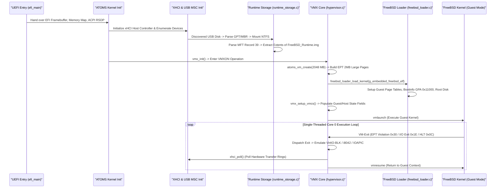

# AUDIT PART 1: SYSTEM MAP & TIMELINE
**Document**: `docs/audit/01_map.md`  
**Classification**: READ-ONLY AUDIT - EVIDENCE-BASED  
**Date**: 2026-11-01  
**Scope**: Directory tree, component sizing, function calls, and boot-to-guest timeline.

---

## 1. Directory Tree & Component Inventory

### 1.1 Hypervisor Subsystem (`kernel/core/hypervisor`)

#### Headers (`kernel/core/hypervisor/include/`)
- `hypervisor.h` (7,037 bytes) [VERIFIED-BY-CODE: `kernel/core/hypervisor/include/hypervisor.h:1-200`]
  - **Purpose**: Defines `VirtualMachine`, `vCPU`, VM exit reasons, VM states (`VM_STATE_CREATED`, `VM_STATE_RUNNING`, etc.), and public lifecycle API (`atoms_hypervisor_boot_genuine_freebsd`, `atoms_hypervisor_runtime_step`).
  - **Caller**: `hypervisor.c`, `hypervisor_dashboard.c`, `kernel.c`.
- `virtual_platform.h` (13,304 bytes) [VERIFIED-BY-CODE: `kernel/core/hypervisor/include/virtual_platform.h:1-350`]
  - **Purpose**: Defines chipset emulation structs: `VirtualPlatform`, `VirtualI8042`, `VirtualUART`, `VirtualIOAPIC`, `VirtualPIC`, `VirtualPIT`, `VirtualRTC`, PCI bus, and input focus state enum (`INPUT_FOCUS_HOST`, `INPUT_FOCUS_GUEST`).
  - **Caller**: `virtual_platform.c`, `hypervisor.c`, `usb_hid.c`.
- `vmx.h` (8,742 bytes) [VERIFIED-BY-CODE: `kernel/core/hypervisor/include/vmx.h:1-250`]
  - **Purpose**: Intel VMX VMCS encoding definitions (guest/host state, execution controls, pin/proc controls, exit reasons per Intel SDM Volume 3C Chapter 24).
  - **Caller**: `hypervisor.c`.
- `ept.h` (3,823 bytes) [VERIFIED-BY-CODE: `kernel/core/hypervisor/include/ept.h:1-120`]
  - **Purpose**: Extended Page Table (EPT) 4-level paging structures, entry bit definitions (Read, Write, Execute, Memory type, 2MB large page flag).
  - **Caller**: `ept.c`, `hypervisor.c`.
- `freebsd_loader.h` (6,490 bytes) [VERIFIED-BY-CODE: `kernel/core/hypervisor/include/freebsd_loader.h:1-180`]
  - **Purpose**: FreeBSD bootinfo, metadata module tags (`MODINFO_NAME`, `MODINFO_TYPE`, `MODINFO_METADATA`), ELF64 header types, and kernel loader entrypoints.
  - **Caller**: `freebsd_loader.c`, `hypervisor.c`.
- `runtime_storage.h` (1,927 bytes) [VERIFIED-BY-CODE: `kernel/core/hypervisor/include/runtime_storage.h:1-60`]
  - **Purpose**: Declarations for `runtime_storage_init()`, `runtime_storage_is_available()`, `runtime_storage_create_guest_blk()`, and `RuntimeStorageTelemetry`.
  - **Caller**: `runtime_storage.c`, `hypervisor.c`, `hypervisor_dashboard.c`.
- `virtio_blk.h` (3,496 bytes) [VERIFIED-BY-CODE: `kernel/core/hypervisor/include/virtio_blk.h:1-110`]
  - **Purpose**: VirtIO-Block device struct `VirtIOBlock`, request headers (`virtio_blk_req_hdr_t`), status bytes, and sector transfer function pointers.
  - **Caller**: `virtio_blk.c`, `hypervisor.c`, `runtime_storage.c`.
- `virtio_net.h` (5,750 bytes) [VERIFIED-BY-CODE: `kernel/core/hypervisor/include/virtio_net.h:1-160`]
  - **Purpose**: VirtIO-Network device struct `VirtIONet`, packet buffer ring, and physical NIC packet forwarding hooks.
  - **Caller**: `virtio_net.c`, `hypervisor.c`.
- `virtio_display.h` (6,302 bytes) [VERIFIED-BY-CODE: `kernel/core/hypervisor/include/virtio_display.h:1-180`]
  - **Purpose**: Shared framebuffer device (`VirtIODisplay`), resolution config (1024x768x32bpp), guest dirty rect tracking, and host BWE composition blit.
  - **Caller**: `virtio_display.c`, `hypervisor.c`, `hypervisor_dashboard.c`.
- `virtio_pci.h` (2,618 bytes), `virtio_device.h` (2,102 bytes), `virtio_queue.h` (2,520 bytes), `virtio_types.h` (7,085 bytes) [VERIFIED-BY-CODE]
  - **Purpose**: Base VirtIO 0.9.5 (legacy PCI) register interface, BAR0 layout, queue descriptor table, available ring, used ring manipulation.
- `atoms_bridge.h` (1,396 bytes) [VERIFIED-BY-CODE: `kernel/core/hypervisor/include/atoms_bridge.h:1-40`]
  - **Purpose**: Interface between host BWE/Desktop and guest display surfaces.

#### Source Files (`kernel/core/hypervisor/src/`)
- `hypervisor.c` (219,904 bytes) [VERIFIED-BY-CODE: `kernel/core/hypervisor/src/hypervisor.c:1-4560`]
  - **Purpose**: Core VMX implementation. Contains VMXON activation, VMCS region allocation and field population, host/guest register state setup, VM-exit dispatcher loop, I/O instruction emulation, CPUID/MSR virtualization, interrupt window injection, and guest vCPU step execution (`atoms_hypervisor_runtime_step`).
  - **Main Functions**: `vmx_init()`, `virtual_machine_create()`, `atoms_vm_launch()`, `atoms_hypervisor_runtime_step()`, `vmx_exit_handler()`, `handle_io_instruction()`, `handle_cr_access()`.
  - **Who Calls It**: `kernel.c` (via dashboard), `hypervisor_dashboard.c`.
- `virtual_platform.c` (85,086 bytes) [VERIFIED-BY-CODE: `kernel/core/hypervisor/src/virtual_platform.c:1-1972`]
  - **Purpose**: Complete IBM PC/AT chipset and platform peripheral virtualization. Contains virtual 8259 dual-PIC, virtual LAPIC, virtual IOAPIC, virtual i8042 keyboard/mouse controller, virtual 16550 UART (COM1 0x3F8), virtual PIT 8254, virtual RTC, virtual PCI bus (0xCF8/0xCFC), and the unified Input Focus Router (`atoms_input_forward_hid_to_i8042`, `atoms_input_set_focus`).
  - **Main Functions**: `virtual_platform_create()`, `virtual_platform_emulate_io()`, `virtual_i8042_push_byte()`, `virtual_i8042_pop_byte()`, `atoms_input_forward_hid_to_i8042()`, `virtual_ioapic_read()`, `virtual_ioapic_write()`.
  - **Who Calls It**: `hypervisor.c` (on Port I/O and MMIO exits), `usb_hid.c` (input router).
- `freebsd_loader.c` (24,147 bytes) [VERIFIED-BY-CODE: `kernel/core/hypervisor/src/freebsd_loader.c:1-560`]
  - **Purpose**: Direct-kernel bootloader for FreeBSD ELF64 kernel. Constructs 64-bit page tables (PML4 at GPA 0x20000), populates FreeBSD `bootinfo_t` (GPA 0x11000) and preload_metadata stream (GPA 0x12000), sets loader environment variables (`vfs.root.mountfrom`, `init_script`, `console=vidconsole`), and loads kernel ELF segments.
  - **Main Functions**: `freebsd_loader_load_kernel()`, `freebsd_loader_setup_bootinfo()`, `freebsd_loader_setup_guest_paging()`, `freebsd_loader_init_root_disk()`.
  - **Who Calls It**: `hypervisor.c` (`atoms_hypervisor_boot_genuine_freebsd`).
- `runtime_storage.c` (34,120 bytes) [VERIFIED-BY-CODE: `kernel/core/hypervisor/src/runtime_storage.c:1-612`]
  - **Purpose**: Runtime block storage provider. Discovers USB Mass Storage, parses GPT/MBR partition table, locates NTFS volume, parses MFT Record 39 for `FreeBSD_Runtime.img`, parses `$ATTRIBUTE_LIST` and `$DATA` runlists into memory extents, and binds to VirtIO-BLK.
  - **Main Functions**: `runtime_storage_init()`, `runtime_storage_read_blocks()`, `runtime_storage_create_guest_blk()`.
  - **Who Calls It**: `virtio_blk.c` (read callback), `hypervisor.c` (initialization).
- `ept.c` (11,136 bytes) [VERIFIED-BY-CODE: `kernel/core/hypervisor/src/ept.c:1-310`]
  - **Purpose**: Extended Page Table builder. Creates 4-level paging hierarchy (PML4 -> PDPT -> PD -> PT) identity mapping GPA 0x0 - 0x80000000 to host physical addresses using 2MB large pages.
  - **Main Functions**: `ept_init_pml4()`, `ept_map_2mb()`, `ept_destroy_pml4()`.
  - **Who Calls It**: `hypervisor.c` (`vmx_setup_ept`).
- `virtio_blk.c` (19,926 bytes) [VERIFIED-BY-CODE: `kernel/core/hypervisor/src/virtio_blk.c:1-510`]
  - **Purpose**: VirtIO Block device implementation. Handles descriptor chain traversal, `VIRTIO_BLK_T_IN` read execution, `VIRTIO_BLK_T_OUT` write rejection, and completion queue notification.
  - **Main Functions**: `virtio_blk_create()`, `virtio_blk_create_file_backed()`, `blk_queue_notify_cb()`, `virtio_blk_read_sectors()`.
  - **Who Calls It**: `hypervisor.c`, `virtual_platform.c` (I/O exit routing).
- `virtio_net.c` (39,034 bytes) [VERIFIED-BY-CODE: `kernel/core/hypervisor/src/virtio_net.c:1-920`]
  - **Purpose**: VirtIO Network adapter. Emulates virtqueues for RX and TX, binds to host Intel I219-V / Realtek NIC driver.
  - **Who Calls It**: `hypervisor.c`.
- `virtio_display.c` (14,484 bytes) [VERIFIED-BY-CODE: `kernel/core/hypervisor/src/virtio_display.c:1-380`]
  - **Purpose**: Virtual display adapter. Provides 1024x768x32bpp linear GPA framebuffer, dirty rect notification.
  - **Who Calls It**: `hypervisor.c`, `hypervisor_dashboard.c`.
- `virtio_input.c` (4,998 bytes) [VERIFIED-BY-CODE: `kernel/core/hypervisor/src/virtio_input.c:1-148`]
  - **Purpose**: Dead VirtIO input device (`0x1052`). Created at PCI slot 3, but `virtio_input_send_key()` and `virtio_input_send_mouse_rel()` have 0 callers in the entire OS.
  - **Who Calls It**: `hypervisor.c:374` (only creation).
- `virtio_pci.c` (14,547 bytes) [VERIFIED-BY-CODE: `kernel/core/hypervisor/src/virtio_pci.c:1-390`]
  - **Purpose**: Emulates VirtIO 0.9.5 legacy PCI BAR0 configuration registers (DeviceFeatures, GuestFeatures, QueueAddress, QueueSize, QueueSelect, QueueNotify, DeviceStatus, ISRStatus).
  - **Who Calls It**: `virtual_platform.c` (PCI I/O handlers).
- `virtio_device.c` (5,115 bytes), `virtio_queue.c` (7,006 bytes) [VERIFIED-BY-CODE]
  - **Purpose**: Queue memory allocation, descriptor ring head/tail tracking.
- `vmx_entry.asm` (4,969 bytes) [VERIFIED-BY-CODE: `kernel/core/hypervisor/src/vmx_entry.asm:1-135`]
  - **Purpose**: Pure x86-64 assembly routines for VMX transitions: `vmx_run_vcpu_raw()`, `vmx_vmlaunch()`, `vmx_vmresume()`, saving/restoring GPRs (RAX-R15), handling VM-exit resumption.
- `guest_memory.c` (11,114 bytes), `atoms_bridge.c` (19,674 bytes), `npt.c` (10,214 bytes) [VERIFIED-BY-CODE]
  - **Purpose**: GPA allocation, AMD-V NPT stubs, host GUI IPC.

---

### 1.2 USB Subsystem (`kernel/drivers/usb`)

#### Classes (`kernel/drivers/usb/class/`)
- `usb_hid.c` (31,452 bytes) [VERIFIED-BY-CODE: `kernel/drivers/usb/class/usb_hid.c:1-778`]
  - **Purpose**: USB Human Interface Device driver. Intercepts mouse and keyboard interrupt transfer completion TRBs, processes 8-byte boot reports, runs the unified Focus Router (`INPUT_FOCUS_HOST` vs `INPUT_FOCUS_GUEST`), dispatches scancodes to host shell or virtual i8042.
- `usb_msc.c` (21,556 bytes) [VERIFIED-BY-CODE: `kernel/drivers/usb/class/usb_msc.c:1-555`]
  - **Purpose**: USB Mass Storage Class Bulk-Only Transport (BOT). Sends 31-byte CBWs (Command Block Wrappers), reads/writes sectors via SCSI `READ(10)` and `WRITE(10)`, verifies 13-byte CSWs (Command Status Wrappers). Contains the synchronous 5000 ms transfer wait in VMCS exit context (`usb_msc.c:124-126`).

#### Host Controller (`kernel/drivers/usb/host/xhci/`)
- `xhci.c` (38,400 bytes), `xhci_transfer.c` (24,100 bytes), `xhci_ring.c` (19,800 bytes) [VERIFIED-BY-CODE]
  - **Purpose**: xHCI 1.1 Host Controller Driver. Command ring management, event ring polling (`xhci_poll()`), transfer ring enqueueing, slot context / endpoint context configuration.

---

## 2. Boot-to-Guest Execution Timeline

---

## 3. Interleaving Architecture: Cooperative Single Thread

On the target ASUS PRIME B760M-K (Intel Core i3-14100F), execution is single-threaded on Core 0:
1. `hypervisor_dashboard_render_runtime_dashboard()` runs on Core 0.
2. It calls `atoms_hypervisor_runtime_step(vm, 500000)` which executes up to 500,000 VM-exits or until 1.5ms wall-clock duration elapses (`hypervisor.c:4030-4050`).
3. Inside the loop, every exit handles one device event (e.g. VirtIO-BLK read, i8042 port read, IOAPIC RTE write).
4. When `atoms_hypervisor_runtime_step()` returns, Core 0 executes:
   - `xhci_poll()`: Checks xHCI Event Ring for pending keyboard, mouse, or MSC completion TRBs.
   - `dashboard_update()`: Updates on-screen telemetry, checks keyboard input for host focus switch chords (Ctrl+Alt+G).
   - Returns to step 2.
