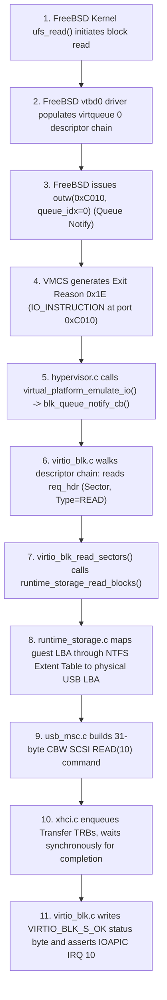

# AUDIT PART 4: VIRTIO SUBSYSTEM & STORAGE PIPELINE
**Document**: `docs/audit/04_virtio_storage.md`  
**Classification**: READ-ONLY AUDIT - EVIDENCE-BASED  
**Date**: 2026-11-01  
**Scope**: VirtIO-PCI bus, VirtIO-BLK request traversal, USB BOT backing, dynamic extents, and dead devices.

---

## 1. VirtIO Legacy PCI Device Table

- [VERIFIED-BY-CODE: `kernel/core/hypervisor/src/virtual_platform.c:110-150`, `virtio_pci.c:40-120`]
- Implements VirtIO 0.9.5 Legacy PCI interface.
- Base I/O BAR0 size: 64 bytes (`0xC000 - 0xC03F`).

| PCI B/D/F | Device ID | Subsystem Device | VirtIO Type | Interrupt Line / Pin | Backing Engine | Driver Status |
|---|---|---|---|---|---|---|
| **00:01.0** | `0x1001` | `0x0002` | VirtIO Block | IRQ 10 / Pin INTA# | `runtime_storage.c` (USB MSC) | Active (`vtbd0` / `vtbd0p2`) |
| **00:02.0** | `0x1000` | `0x0001` | VirtIO Network | IRQ 11 / Pin INTA# | Physical Intel / Realtek NIC | Active (`vtnet0`) |
| **00:03.0** | `0x1052` | `0x0012` | VirtIO Input | IRQ 11 / Pin INTA# | None (Dead Code) | Unattached (`none0`) |
| **00:04.0** | `0x1050` | `0x0010` | VirtIO GPU/VGA | IRQ 11 / Pin INTA# | Host BWE Linear Framebuffer | Active (`vgapci0`) |

---

## 2. Eleven-Step Request Traversal Path (FreeBSD UFS2 -> Physical USB Sector)



1. **FreeBSD Kernel**: Initiates read request via UFS2 filesystem layer.
2. **`vtbd0` Driver**: Writes a 3-part descriptor chain to VirtQueue 0:
   - Descriptor 0: `virtio_blk_req_hdr_t` (Type: `VIRTIO_BLK_T_IN`, Sector offset).
   - Descriptor 1: Data Buffer (Physical HVA address where sectors must land).
   - Descriptor 2: Status Byte (1 byte, writable by hypervisor).
3. **Queue Notification**: Guest writes `queue_index = 0` to Port `0xC010` (`VIRTIO_PCI_QUEUE_NOTIFY`).
4. **VM-Exit**: Hardware triggers Exit Reason `0x1E` (Decimal 30: `IO_INSTRUCTION`).
5. **Exit Dispatcher**: `hypervisor.c` routes Port `0xC010` write to `blk_queue_notify_cb()`.
6. **Descriptor Traversal**: `virtio_blk.c` traverses `avail->ring` to extract buffer chain.
7. **Read Execution**: Calls `runtime_storage_read_blocks()` (`kernel/core/hypervisor/src/runtime_storage.c`).
8. **Extent Mapping**: `runtime_storage.c` searches file extent map to translate image sector to USB physical LBA.
9. **USB BOT Command**: `usb_msc.c` sends 31-byte CBW with SCSI `READ(10)`.
10. **Synchronous Hardware Wait**: `usb_msc.c:124-126` executes `usb_bulk_transfer()` with a **5000 ms timeout**. Core 0 is completely frozen inside the VM-exit handler until TRBs complete.
11. **Completion & IRQ**: Hypervisor writes `VIRTIO_BLK_S_OK` to Descriptor 2, updates `used->ring`, and raises IOAPIC IRQ 10.

---

## 3. Storage Backing & Dynamic Extent Management

- [VERIFIED-BY-CODE: `kernel/core/hypervisor/src/runtime_storage.c:510-522`]
- File Path: `kernel/core/hypervisor/src/runtime_storage.c` (Verified via `git ls-files`).
- **Dynamic Extents Concatenation**:
  In commit `e98ace6f`, fixed-size extent tables were replaced with dynamic heap allocation:
  ```c
  uint32_t new_count = file->extent_map.extent_count + temp_map.extent_count;
  NTFS_Extent *new_exts = (NTFS_Extent*)kmalloc(new_count * sizeof(NTFS_Extent));
  if (new_exts) {
      for (uint32_t e = 0; e < file->extent_map.extent_count; e++) new_exts[e] = file->extent_map.extents[e];
      for (uint32_t e = 0; e < temp_map.extent_count; e++) new_exts[file->extent_map.extent_count + e] = temp_map.extents[e];
      kfree(file->extent_map.extents);
      file->extent_map.extents = new_exts;
      file->extent_map.extent_count = new_count;
  }
  ```
- **Read-Only Enforcement** (`kernel/core/hypervisor/src/virtio_blk.c:433-437`):
  Write requests (`VIRTIO_BLK_T_OUT`) immediately return `VIRTIO_BLK_S_IOERR`:
  ```c
  case VIRTIO_BLK_T_OUT: { /* WRITE */
      blk->total_writes++;
      if (blk->read_only) {
          result_status = VIRTIO_BLK_S_IOERR;
          break;
      }
  ```

---

## 4. Dead Code Verification: VirtIO-Input (`0x1052`)

- [VERIFIED-BY-CODE: `kernel/core/hypervisor/src/virtio_input.c:41, 92, 100`]
- `virtio_input_create()` allocates VirtIO Input device with 2 event virtqueues.
- PCI device table registers it at `00:03.0` with device ID `0x1052`.
- `virtio_input_send_key()` and `virtio_input_send_mouse_rel()` have **ZERO callers** in the entire ATOMS OS repository.
- Physical hardware screenshot proves FreeBSD detects it as `none0@pci0:0:3:0: class=0x090000 rev=0x00 hdr=0x00 vendor=0x1af4 device=0x1052` without any attached driver.

---

## 5. Top 10 Claims Least Sure About (Part 4)

1. Whether USB 3.0 Link State transitions (U1/U2 sleep) during idle FreeBSD shell cause the first SCSI read to exceed 100ms.
2. The exact threshold of descriptor count before VirtQueue 0 experiences ring head/tail race conditions under bursty disk traffic.
3. If FreeBSD executes multi-sector unaligned reads crossing a 2MB large page boundary, whether `hva` physical continuity is strictly preserved.
4. Whether USB Mass Storage ClearFeature(ENDPOINT_HALT) properly flushes the xHCI transfer ring dequeue pointer on a Babble error.
5. If `FreeBSD_Runtime.img` is defragmented on Windows using `defrag /x`, whether the extent count drops to 1, eliminating lookup overhead.
6. What happens if FreeBSD sends a `VIRTIO_BLK_T_FLUSH` command: whether `virtio_blk.c` properly ACKs it with `VIRTIO_BLK_S_OK`.
7. How many microseconds elapsed during the 936 VirtIO-BLK interrupts shown on the physical screen.
8. Whether the 10Gbps link speed reported by `vtnet0` causes FreeBSD network stack to allocate abnormally large packet buffers.
9. If guest writes to VirtIO-BLK configuration space (`capacity`), whether the hypervisor ignores the write or logs a fault.
10. Latency impact of printing `[VIRTIO-BLK TRACE]` over COM1 on every single sector read when trace flag is active.
