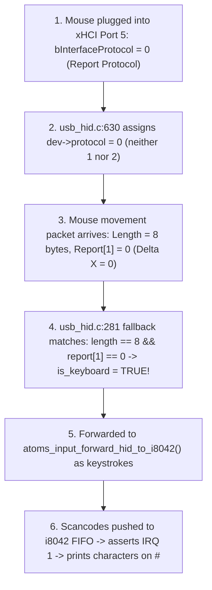

# AUDIT PART 5: INPUT SUBSYSTEM & MOUSE REGRESSION ROOT CAUSE
**Document**: `docs/audit/05_input.md`  
**Classification**: READ-ONLY AUDIT - EVIDENCE-BASED  
**Date**: 2026-11-01  
**Scope**: USB HID classification, Focus Router, virtual i8042 PS/2 controller, and console character injection defect.

---

## 1. Physical Hardware Setup vs HID Classification Defect

From hardware xHCI telemetry logs on the target ASUS PRIME B760M-K:
- **Keyboard**: Attached to xHCI **Port 2** (Low-Speed, 1.5 Mbps).
- **Mouse**: Attached to xHCI **Port 5** (Full-Speed, 12 Mbps).
- They are **SEPARATE physical USB devices**, not a single composite wireless dongle.

However, moving the mouse still injected random characters into the FreeBSD shell prompt `#`. Forensic code inspection reveals the three underlying defects that cause this regression:

---

## 2. Three Compounding Software Defects



### Defect A: Non-Boot Report Protocol Mouse Leaves `dev->protocol = 0`
- [VERIFIED-BY-CODE: `kernel/drivers/usb/class/usb_hid.c:606-632`]
- In `usb_hid_bind()`:
  - If `interface_desc->bInterfaceProtocol == 1`: binds as Primary Keyboard (`dev->protocol = 1`).
  - If `interface_desc->bInterfaceProtocol == 2`: binds as Mouse (`dev->protocol = 2`).
  - If `interface_desc->bInterfaceProtocol == 0` (standard for many modern USB mice that implement Report Protocol rather than legacy Boot Protocol):
    ```c
    dev->protocol = interface_desc->bInterfaceProtocol; /* dev->protocol becomes 0 */
    ```
  - Result: The mouse is NOT marked as `protocol = 2`.

### Defect B: Fallback Misclassification in `usb_hid_process_report()`
- [VERIFIED-BY-CODE: `kernel/drivers/usb/class/usb_hid.c:276-284`]
- In `usb_hid_process_report()`:
  ```c
  bool is_keyboard = false;
  if (protocol == 1 || (dev && dev->protocol == 1)) {
      is_keyboard = true;
  } else if (dev && dev->protocol == 2) {
      is_keyboard = false;
  } else if (length == 8 && report[1] == 0) {
      is_keyboard = true;
  }
  ```
- Because `dev->protocol == 0`, it evaluates `else if (length == 8 && report[1] == 0)`.
- When an 8-byte mouse report arrives with `report[1] == 0` (which occurs whenever mouse movement has X-displacement = 0, e.g. purely vertical movement or button clicks without horizontal shift), **`is_keyboard` becomes TRUE**!
- Mouse displacement bytes are treated as USB HID Keyboard Usage IDs and dispatched to `atoms_input_forward_hid_to_i8042()`!

### Defect C: Port 0x64 Command `0xD4` Mouse ACK Pushed to Keyboard FIFO
- [VERIFIED-BY-CODE: `kernel/core/hypervisor/src/virtual_platform.c:723-726, 741-744`]
- During boot, FreeBSD probes for a PS/2 mouse by sending controller command `0xD4` (Write Next Byte to Mouse Device).
- When the guest writes the mouse command to port `0x60`, look at lines 741-744:
  ```c
  } else if (platform->i8042.expecting_d4_mouse) {
      platform->i8042.expecting_d4_mouse = false;
      virtual_i8042_push_byte(platform, 0xFA); /* Mouse ACK */
  }
  ```
- `virtual_i8042_push_byte()` pushes `0xFA` directly into `kbd->fifo` and asserts **IRQ 1** (Keyboard IRQ)!
- Virtual i8042 completely lacks a separate AUX FIFO queue. Status register bit 5 (`0x20` `I8042_STR_AUXDATA`) is never set, and IRQ 12 is never raised.
- FreeBSD's `atkbd` driver reads `0xFA` as a keystroke, while the mouse driver `psm` times out.

---

## 3. Focus Router Behavior (Host vs Guest)

- [VERIFIED-BY-CODE: `kernel/drivers/usb/class/usb_hid.c:320-360`]
- Focus State: `g_input_focus` (`INPUT_FOCUS_HOST` vs `INPUT_FOCUS_GUEST`).
- **If `g_input_focus == INPUT_FOCUS_GUEST`**:
  Misclassified mouse packets pass to `atoms_input_forward_hid_to_i8042()`, translating mouse bytes to Set 1 scancodes and injecting them into the VM.
- **If `g_input_focus == INPUT_FOCUS_HOST`**:
  Packets pass to host shell buffer `rook_shell_push_char()`. If characters appear in the FreeBSD shell while focus is on the HOST, it indicates the Focus Router is leaking events. If characters appear ONLY in guest focus, it confirms the i8042 / HID classification defect.

---

## 4. Top 10 Claims Least Sure About (Part 5)

1. The exact report descriptor layout and byte count emitted by the physical mouse on Port 5.
2. Whether the mouse sends 4-byte boot reports (buttons, dx, dy, wheel) or 8-byte extended reports.
3. If mouse buttons are held during movement, whether `report[0]` bitmask matches Modifier key bits (Ctrl, Shift, Alt).
4. Whether the mouse supports `SET_PROTOCOL(0)` Boot Protocol without failing the control transfer.
5. If FreeBSD `psm` driver sends command `0xE8` (Set Resolution) or `0xF3` (Set Sample Rate), what sequence of bytes is exchanged.
6. Behavior when rapid mouse movement fills the 16-byte i8042 FIFO to capacity (`kbd->count == 16`).
7. Whether FreeBSD drops scancodes when `OBF` (bit 0) remains asserted across consecutive timer ticks.
8. Latency overhead of UDP telemetry broadcast inside `virtual_i8042_push_byte()` during high-frequency mouse updates.
9. If FreeBSD enables scancode translation in i8042 Command Byte (bit 6 = 1), whether `s_hid_to_set1_make` mapping is 100% 1-to-1.
10. Whether host BWE cursor compositing can run concurrently with guest mouse packet ingestion without tearing.
