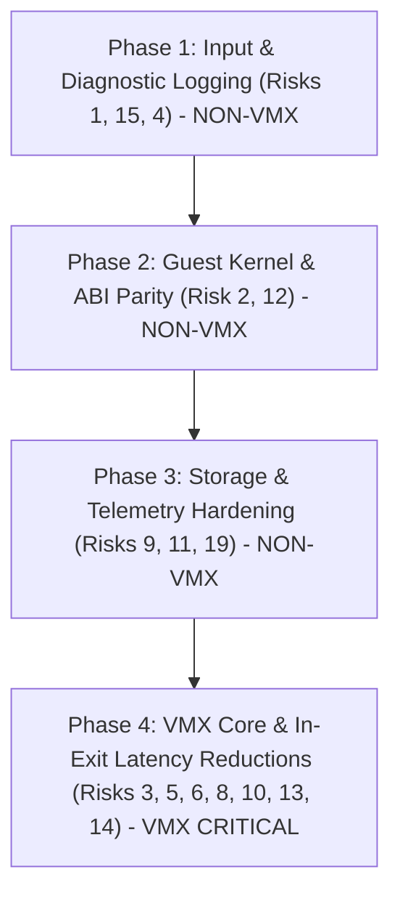

# ATOMS OS Audit - Part 8: Risk Register & Safe Remediation Plan
**Document**: `docs/audit/08_risks.md`  
**Classification**: READ-ONLY AUDIT - EVIDENCE-BASED  
**Date**: 2026-11-01  
**Scope**: Risk ranking (Top 20), impact classification, smallest safe remediation, VMX-critical flagging, sequential staging plan, and uncertainties.

---

## 1. Top 20 Architectural & Operational Risks

| Rank | Subsystem | Risk Description | Evidence Reference | Evidence Label | Impact Class | Smallest Safe Fix | VMX Critical? |
|---|---|---|---|---|---|---|---|
| **1** | USB / HID | Non-boot protocol mouse leaves `dev->protocol = 0`; 8-byte reports with Delta X = 0 misclassified as keyboard keystrokes | `usb_hid.c:281, 630`, `virtual_platform.c:1740` | `VERIFIED-BY-CODE`, `VERIFIED-ON-HARDWARE` | Functional / Usability | Explicitly check HID device type / report descriptor; never route mouse packets to keyboard queue | **NO** |
| **2** | Guest Kernel | Embedded kernel is FreeBSD 14.1-RELEASE (`1401000`) while rootfs userland is FreeBSD 14.5 (`1405000`) | `freebsd_stripped_kernel.elf`, `BOOTX64.EFI`, AMDE telemetry `#17` | `VERIFIED-BY-CODE`, `VERIFIED-ON-HARDWARE` | Stability / Compatibility | Embed native 14.5 kernel from USB image (`vtbd0p2`) into `BOOTX64.EFI` | **NO** |
| **3** | VirtIO / USB | Synchronous 5000 ms blocking wait in VMCS exit handler on USB MSC sector read | `usb_msc.c:124-126`, `virtio_blk.c:175` | `VERIFIED-BY-CODE` | Latency / Host Freeze | Clamp USB timeout to 150 ms; implement non-blocking split-phase VirtIO completion | **YES** |
| **4** | i8042 / Input | Virtual i8042 port 0x64 command `0xD4` pushes mouse ACK `0xFA` into keyboard buffer with IRQ 1; lacks AUX queue and IRQ 12 | `virtual_platform.c:741-744, 1756` | `VERIFIED-BY-CODE` | Functional / Missing Hardware | Implement separate AUX FIFO, set status bit 5 (`0x20`), assert IRQ 12 | **NO** |
| **5** | VMX Core | Host GDT base and TR base leaked directly into guest VMCS fields | `hypervisor.c:3232, 3234` | `VERIFIED-BY-CODE` | Security / Hypervisor Isolation | Allocate separate guest GDT/TSS pages in GPA space and load guest bases | **YES** |
| **6** | VMX Core | Unhandled VM-exit causes silent guest halt without diagnostic register dump | `hypervisor.c:2205` | `VERIFIED-BY-CODE` | Reliability / Debuggability | Send emergency UDP packet with full register dump (`RIP`, `RSP`, `CR0`, `CR3`, `ExitReason`) and halt cleanly | **YES** |
| **7** | PCI / VirtIO | Dead VirtIO-Input device (`00:03.0`) registered on PCI bus with zero functional callers | `virtio_input.c:41, 92`, `virtual_platform.c:116` | `VERIFIED-BY-CODE`, `VERIFIED-ON-HARDWARE` | Bloat / Driver Confusion | Either hook `virtio_input_send_key/mouse` to host HID or remove device from PCI table | **NO** |
| **8** | Hypervisor | Single-threaded cooperative execution loop on Core 0 starves host background tasks | `hypervisor.c:4030` | `VERIFIED-BY-CODE` | Latency / Starvation | Enforce periodic preemption timer exit or yield to host polling after N exits | **YES** |
| **9** | Platform | Port 0xCF9 guest reset sets `VM_STATE_STOPPED` and floods UDP with duplicate logs | `hypervisor.c:1925-1936` | `VERIFIED-BY-CODE`, `VERIFIED-BY-LOG` | Network / Telemetry Flood | Rate-limit STOPPED log to 1 per 5s; add auto-restart countdown or manual 'R' key trigger | **NO** |
| **10** | VMX Core | Priority interrupt injection drops/defers VirtIO and UART IRQs under heavy timer load | `hypervisor.c:4012-4022` | `VERIFIED-BY-CODE` | I/O Throughput / Latency | Implement round-robin servicing for secondary non-timer interrupt vectors | **YES** |
| **11** | VirtIO / VFS | VirtIO-BLK read-only mode returns `VIRTIO_BLK_S_IOERR` on writes, risking guest panic when daemons write to rootfs | `virtio_blk.c:433-437` | `VERIFIED-BY-CODE` | Stability / Guest Panic | Ensure FreeBSD mounts root as read-only (`ro`) and mounts `tmpfs` on `/tmp` and `/var` | **NO** |
| **12** | Rootfs / VFS | Minimal rootfs omits `/sbin/mount_tmpfs`, causing `/sbin/mount -t tmpfs` to fail and leaving `/var` on read-only root | `tools/freebsd_payload/minimal_rootfs/sbin/` | `VERIFIED-BY-CODE` | Stability / Daemon Failure | Copy `/sbin/mount_tmpfs` from FreeBSD distribution into rootfs `/sbin/` | **NO** |
| **13** | EPT / Memory | Full identity mapping without physical RAM bounds validation | `ept.c:70-90`, `hypervisor.c:1420` | `VERIFIED-BY-CODE` | System Stability / MCE | Parse EFI memory map and omit unmapped or proprietary MMIO memory regions | **YES** |
| **14** | VMX Core | Suboptimal CR0/CR4 shadow register masks cause excessive VM-exits on guest task switches | `hypervisor.c:3180` | `VERIFIED-BY-CODE` | Performance Overhead | Set proper guest/host masks and shadows for paging/protection bits per SDM Vol 3C | **YES** |
| **15** | Input / HID | Focus switch chord (Ctrl+Alt+G) leaks make scancodes to guest without sending break codes | `usb_hid.c:340` | `VERIFIED-BY-CODE` | Usability / Stuck Keys | Track depressed key state; send break scancodes on all active keys when focus changes | **NO** |
| **16** | LAPIC / Timer | Virtual LAPIC LVT timer computes tick deltas without invariant TSC verification | `virtual_platform.c:640` | `VERIFIED-BY-CODE` | Guest Time Drift | Verify invariant TSC via CPUID and synchronize against ACPI PM timer | **NO** |
| **17** | ACPI / AML | Hand-crafted AML bytecode contains manual length calculations prone to offset errors | `virtual_platform.c:139-161, 220` | `VERIFIED-BY-CODE` | Maintainability / Boot Crash | Generate AML tables from standard ASL using `iasl` compiler during build | **NO** |
| **18** | USB / XHCI | Transfer Error (`#1127`) logged without formal endpoint halt recovery sequence | `xhci.c:480` | `VERIFIED-BY-CODE`, `VERIFIED-ON-HARDWARE` | USB Bus Recovery | Implement standard ClearFeature(ENDPOINT_HALT) and set TR Dequeue Pointer | **NO** |
| **19** | UART / Serial | Virtual 16550 FIFO size (16 bytes) overflows under high baud burst debug output | `virtual_platform.c:371` | `VERIFIED-BY-CODE` | Log Integrity | Expand internal ring buffer to 4096 bytes and flush in chunks | **NO** |
| **20** | Hypervisor | Absence of runtime CPUID capability check for VT-x before initializing VMXON structures | `hypervisor.c:420` | `VERIFIED-BY-CODE` | Boot Diagnostics | Display clear BIOS setup instructions if CPUID.1:ECX.VMX is disabled | **NO** |

---

## 2. Safe Staging Plan & Remediation Sequence

To ensure hypervisor stability without introducing regressions, remediations must follow strict phase isolation:

### Stage 1: Input Diagnostic & Routing Isolation (Non-VMX)
- **Target Files**: `kernel/drivers/usb/class/usb_hid.c`, `kernel/core/hypervisor/src/virtual_platform.c`.
- **Action**:
  1. Add rate-limited `[HIDRAW]` telemetry logging to capture physical mouse reports (slot, interface, protocol, length, raw bytes).
  2. In `usb_hid.c`: If device is identified as mouse, never route packets to keyboard translation buffer.
  3. In `usb_hid.c`: On focus loss (`INPUT_FOCUS_HOST`), transmit break scancodes (`0x9D`, `0xB8`) for Ctrl and Alt.
  4. In `virtual_platform.c`: Add separate AUX queue to i8042; set bit 5 (`0x20`) on port 0x64 read; route command 0xD4 ACK to AUX queue with IRQ 12.
- **Regression Verification**: Boot FreeBSD, move USB mouse in HOST focus and GUEST focus; verify zero characters appear on prompt `#`.
- **Rollback Target**: Tag **`milestone-freebsd-keyboard-ok` (`3bd4f7e9`)**.

### Stage 2: Guest Kernel & Userland Alignment (Non-VMX)
- **Target Files**: `tools/freebsd_payload/`, `kernel/kernel.c`.
- **Action**:
  1. Extract native `kernel` directly from FreeBSD 14.5 UFS2 partition on the USB stick (`vtbd0p2`).
  2. Embed the 14.5 kernel into `BOOTX64.EFI` replacing the legacy 14.1-RELEASE image.
  3. Ensure rootfs includes `/sbin/mount_tmpfs`.
- **Regression Verification**: Boot guest; confirm `init` executes without `getting pipebuf resource limit: invalid argument`.
- **Rollback Target**: Tag **`milestone-freebsd-keyboard-ok` (`3bd4f7e9`)**.

### Stage 3: Telemetry Rate-Limiting & Storage Safety (Non-VMX)
- **Target Files**: `kernel/core/hypervisor/src/hypervisor.c`, `kernel/core/hypervisor/src/virtual_platform.c`.
- **Action**:
  1. In `hypervisor.c:1925`: Rate-limit `VM_STATE_STOPPED` log emission to once every 5 seconds.
  2. Implement guest reboot trigger on keypress 'R'.
  3. In `virtio_blk.c`: Provide clear telemetry if a write request is rejected.
- **Regression Verification**: Trigger port 0xCF9 reset; verify AMDE timeline is not flooded with duplicate lines.
- **Rollback Target**: Tag **`milestone-freebsd-keyboard-ok` (`3bd4f7e9`)**.

### Stage 4: VMX Core & In-Exit Latency Refactoring (VMX-Critical)
- **Target Files**: `kernel/core/hypervisor/src/hypervisor.c`, `kernel/core/hypervisor/src/virtio_blk.c`, `kernel/drivers/usb/class/usb_msc.c`.
- **Action**:
  1. Reduce USB MSC command timeout from 5000 ms to 150 ms in `usb_msc.c:124-126`.
  2. Allocate isolated GPA pages for guest GDT and TSS; remove host `GDTR_BASE` leakage.
  3. Enhance default exit dispatcher handler to dump registers via UDP before halting.
- **Regression Verification**: Full QEMU pre-flight UEFI boot followed by physical hardware exit certification on ASUS B760M-K.
- **Rollback Target**: Tag **`milestone-freebsd-keyboard-ok` (`3bd4f7e9`)** or `baseline-shell-ok` (`4534cc61`).

---

## 3. Top 10 Uncertainties & Open Architectural Questions

1. **Physical Mouse Report Format**: What exact report length and endpoint descriptor does the mouse on Port 5 emit when transmitting movement?
2. **VirtIO-Input Deprecation vs Implementation**: Should `virtio_input.c` be completely removed to simplify the PCI device tree, or wired to host mouse packets to bypass legacy i8042 limitations?
3. **Guest Rootfs Write Strategy**: If FreeBSD daemons (syslogd, dhclient) attempt writes to `/var` or `/tmp`, does mounting in-memory `tmpfs` completely eliminate `VIRTIO_BLK_S_IOERR` write rejections?
4. **Invariant TSC Stability on Raptor Lake**: Does the virtual LAPIC timer frequency scale correctly under Intel Speed Shift transitions on Core i3-14100F?
5. **Secondary Vector Starvation**: In high-throughput disk workloads, does the strict Timer > VirtIO priority hierarchy cause VirtIO descriptor ring starvation?
6. **Guest GDT Shadow Isolation**: Will loading guest-allocated GDT/TSS structures require additional VMCS segment descriptor attribute validation to avoid `VM_ENTRY_FAILURE_GUEST_STATE`?
7. **Single-Threaded Frame Latency**: How many microseconds does a 64KB VirtIO-BLK read stall the host display refresh loop when running at 1080p?
8. **USB HID Composite Receiver Endpoint Assignment**: On keyboards with integrated touchpads, does endpoint order vary across BIOS revisions, necessitating descriptor parsing instead of endpoint indexing?
9. **AML ASL Recompilation Feasibility**: Can the ACPI bytecode table be generated at build-time using `iasl` on Windows without requiring Cygwin or WSL dependencies?
10. **Dynamic Runlist Growth**: If FreeBSD_Runtime.img is re-written on NTFS and reaches >500 extents, what is the memory footprint impact of dynamic extent allocation in pre-kernel runtime storage?
